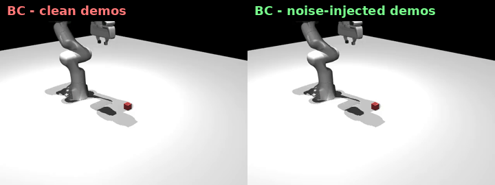
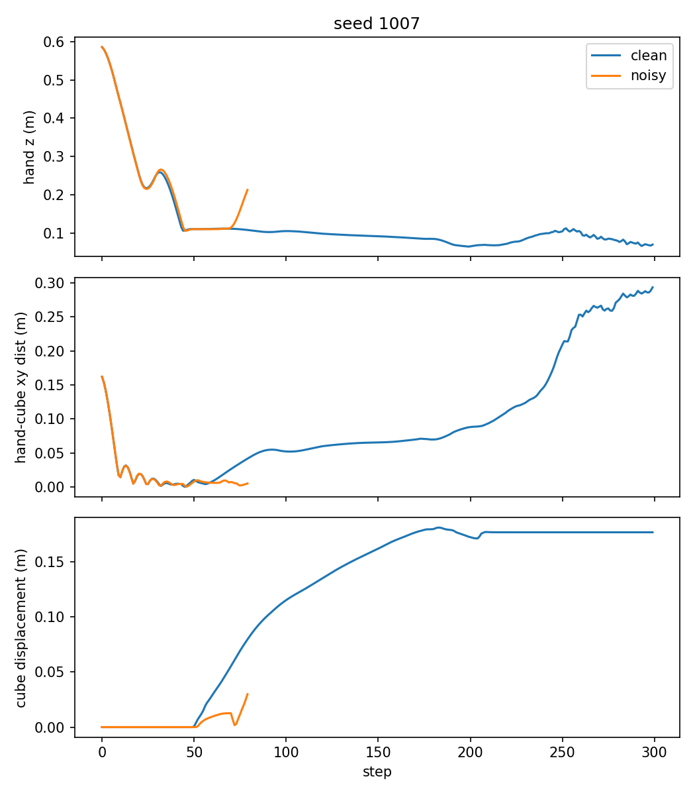

# Behavior Cloning for Robotic Pick-and-Lift (Franka Panda, MuJoCo)

A from-scratch imitation learning pipeline that teaches a simulated 7-DoF Franka Emika Panda arm to pick up a cube. I built the environment, wrote a scripted expert, collected demonstrations, trained neural-network policies with behavior cloning (BC), and then measured **why** the policies fail, not only how often.

**Main result:** a policy trained on demonstrations where noise was injected into the expert's actions picks up the cube **67%** of the time. The same network trained on clean demonstrations manages **48%**, and the expert it learned from manages **59%**. Adding the noise addresses *covariate shift*, the most common way behavior cloning fails.

<p align="center">
  
</p>

<p align="center">
  
</p>

> Seed 1007: both policies reach the cube along the same path. The **clean** policy (blue) brushes the cube as it closes the gripper, then keeps pushing it away for 250 steps. The **noisy** policy (orange) recovers from the same small disturbance, grasps, and lifts by step 80.
> Videos: [`videos/clean_seed1007.mp4`](videos/clean_seed1007.mp4) · [`videos/noisy_seed1007.mp4`](videos/noisy_seed1007.mp4)

---

## Results

Evaluated on **300 held-out cube positions** (seeds 1000–1299, never seen in training).

| Policy | Success | Cube knocked away | Grasp failed | Did not descend | Never closed gripper |
|---|---:|---:|---:|---:|---:|
| Scripted expert | 177 / 300 (**59%**) | 55 | 64 | 0 | 4 |
| BC, clean demos | 145 / 300 (**48%**) | 128 | 10 | 17 | 0 |
| **BC, noise-injected demos** | **202 / 300 (67%)** | 68 | 19 | 11 | 0 |

Success rate by where the cube starts:

| Policy | Near cubes (x < 0.46 m) | Far cubes (x ≥ 0.46 m) |
|---|---:|---:|
| Scripted expert | 85% | 47% |
| BC, clean demos | 46% | 49% |
| BC, noise-injected demos | **82%** | **60%** |

### What the numbers show

- **Clean BC fails mostly by knocking the cube away** (128 of 155 failures). It only ever saw perfect expert trajectories. When it nudges the cube even slightly, it ends up in a state that never appears in its training data, and it does not know how to recover. The error compounds, which is the classic covariate-shift failure of behavior cloning.
- **Noise injection mostly fixes this.** During data collection I add Gaussian noise (σ = 0.1) to the actions that are *executed*, but I record the expert's *clean* action as the label (similar to DART, Laskey et al. 2017). The dataset then contains small deviations paired with the right correction, so the policy learns to recover. "Cube knocked" failures drop from 128 to 68.
- **The student beats the teacher.** The noisy BC policy outperforms the scripted expert overall, and the gap is largest on far-away cubes (60% vs 47%). One plausible explanation is that the expert's hard-coded phase thresholds are brittle at the edge of the workspace, while the learned policy behaves more smoothly there; I haven't isolated the cause yet.

---

## How it works

```
 scripted expert ──► demonstrations (HDF5) ──► MLP policy (PyTorch) ──► evaluation + failure analysis
  (state machine)     clean / noise-injected      behavior cloning         300 held-out seeds
```

### 1. Environment ([`envs/panda_env.py`](envs/panda_env.py))
- MuJoCo simulation of the Franka Panda (from [MuJoCo Menagerie](https://github.com/google-deepmind/mujoco_menagerie)) with a 4 cm, 50 g cube placed uniformly at random in a 40 × 20 cm workspace.
- **Observation (14-D):** 7 joint angles, gripper opening, hand position (xyz), cube position (xyz).
- **Action (4-D):** Cartesian hand velocity (dx, dy, dz) in [-1, 1], scaled to at most 2 cm per step, plus a gripper open/close command.
- **Controller:** I wrote a damped-least-squares inverse kinematics controller that maps Cartesian actions to joint targets using the MuJoCo Jacobian. It holds the hand orientation fixed and limits integrator windup.
- **Success:** the cube is lifted to more than 10 cm within 300 steps.

### 2. Scripted expert ([`expert/scripted_expert.py`](expert/scripted_expert.py))
A four-phase state machine: **approach** above the cube → **descend** → **close** the gripper → **lift**. I tuned the grasp height with a parameter sweep ([`sweep_expert.py`](expert/sweep_expert.py)) and diagnosed failures by cube position ([`failure_map.py`](expert/failure_map.py), [`debug_expert.py`](expert/debug_expert.py)).

### 3. Demonstration collection ([`expert/collect_demos.py`](expert/collect_demos.py))
I ran the expert on 300 random cube positions and kept only successful episodes:
- `data/demos_clean.h5`: 249 episodes, about 20.5k state-action pairs (no noise)
- `data/demos_noisy.h5`: 255 episodes, about 21k state-action pairs (σ = 0.1 noise on executed actions, clean labels)

### 4. Behavior cloning ([`bc/train.py`](bc/train.py))
- MLP with 3 × 256 hidden units, ReLU, and a `tanh` output that matches the [-1, 1] action range. Trained with MSE regression on expert actions.
- **Train/validation split by episode, not by timestep.** Timesteps within an episode are highly correlated, so splitting by timestep would leak data between the sets.
- Observations are normalized with statistics from the training set only. Training uses Adam with a cosine learning-rate schedule for 100 epochs and keeps the checkpoint with the best validation loss.

### 5. Evaluation and failure analysis ([`eval/`](eval/))
- [`evaluate.py`](eval/evaluate.py) runs any policy (or the expert) on held-out seeds and sorts each failure into a category (*never reached cube*, *did not descend*, *never closed gripper*, *cube knocked*, *grasp failed*) using signals logged during the episode.
- [`trace_seed.py`](eval/trace_seed.py) and [`trace_detail.py`](eval/trace_detail.py) compare the clean and noisy policies step by step on the same seed, to find exactly when and why the clean policy loses the cube.
- [`envs/render_compare.py`](envs/render_compare.py) automatically finds seeds where the clean policy knocks the cube but the noisy one succeeds, and renders both side by side to MP4 (headless EGL rendering).

---

## Repository layout

```
envs/      MuJoCo Panda pick environment, IK controller, headless rendering, scene XMLs
expert/    scripted expert, demo collection, tuning and debugging tools
bc/        behavior cloning training script
eval/      evaluation, failure categorization, per-seed traces, result CSVs
data/      collected demonstrations (HDF5)
models/    trained policy checkpoints (bc_clean.pt, bc_noisy.pt)
videos/    rendered rollouts
```

## Reproducing

```bash
python -m venv .venv && source .venv/bin/activate
pip install mujoco==3.14.0 torch numpy h5py matplotlib imageio imageio-ffmpeg
git clone https://github.com/google-deepmind/mujoco_menagerie.git   # provides the Panda meshes

# 1. collect demonstrations
python expert/collect_demos.py --noise 0.0 --out data/demos_clean.h5
python expert/collect_demos.py --noise 0.1 --out data/demos_noisy.h5

# 2. train
python bc/train.py --data data/demos_clean.h5 --out models/bc_clean.pt
python bc/train.py --data data/demos_noisy.h5 --out models/bc_noisy.pt

# 3. evaluate on 300 held-out seeds
python eval/evaluate.py --expert --n 300 --name expert_300
python eval/evaluate.py --model models/bc_clean.pt --n 300 --name bc_clean_300
python eval/evaluate.py --model models/bc_noisy.pt --n 300 --name bc_noisy_300

# 4. analysis and videos
python eval/trace_seed.py 1007
MUJOCO_GL=egl python envs/render_compare.py
```

> **Scene files** live in [`envs/assets/`](envs/assets/). `pick_scene.xml` adds a floor, a light, and a free-floating cube to the Panda model. `panda_bc.xml` is the Menagerie `panda.xml` (Apache-2.0) with the `home` keyframe removed, because the keyframe's joint vector no longer matches once the cube's free joint is added. Its `meshdir` points to the Menagerie clone in the repo root, so the 33 MB of meshes aren't duplicated here.

## Skills demonstrated
Imitation learning · robot simulation (MuJoCo) · inverse kinematics and Jacobian-based control · PyTorch · experimental design with held-out evaluation · systematic failure analysis · data pipelines (HDF5) · headless rendering

## Possible next steps
- DAgger (interactive expert relabeling), to compare against noise injection
- Action chunking or diffusion policies to handle the multi-modal grasp timing
- Vision-based observations instead of ground-truth cube position
- Multiple training seeds with confidence intervals
